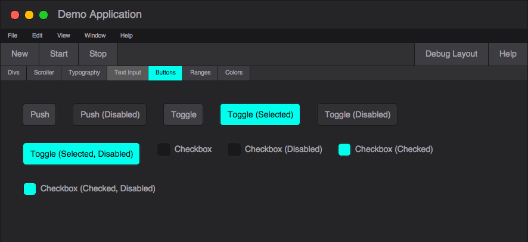

> [!WARNING]  
> While I would love to continue this project because I believe it still has potential, I have no plan to restart development in the near future. Thanks to everyone who have starred, used or contributed to it.

# Psychic UI

[](https://github.com/ubald/psychic-ui/actions/workflows/ci.yml)



## Roadmap

https://trello.com/b/XYz6BS9v

## What is it?

This is a cross-platform (Mac/Linux initially) C++/OpenGL UI library.

### Why make it?

As I was looking around for options I grew tired of seeing countless projects with no attention to detail and very little customization possibilities.
Most of the libraries seemed to focus on creating windows inside of windows and didn't include much widget/component options beside the bare minimum. 
Being able to create complex layouts with constraints was also a requirement. So this is why I started working on this project.
    
## What's with the name?

This is intended to be part of a future larger project so it is named according to that projet's name. I intend to make
sources available as much as possible for all of the project's parts in the form of libraries like this.

## Architecture

The library uses:

* [SDL3](https://www.libsdl.org/) for windows, input and the OpenGL context
* [Skia](https://skia.org/) for drawing shapes and text
* [Yoga](https://facebook.github.io/yoga/) for the layout

### Running it, or embedding it

`psychic_ui::SDL3Application` runs Psychic UI on its own: it opens an SDL window for each `Window` and runs
the loop.

```cpp
psychic_ui::SDL3Application app;
app.open(std::make_shared<MyWindow>());
app.run();
```

An application that already has a window, a GL context and a loop embeds Psychic UI with an adapter instead,
the way Dear ImGui's backends work: `SDL3SystemWindow` for an SDL3 window, `GLFWSystemWindow` for a GLFW
window. The host passes events (SDL) or keeps its callbacks, which the adapter chains to (GLFW), and calls
`render()` each frame. Their headers in `psychic-ui/applications/` show how; `example/glfw-host` is a
complete GLFW host.

## Sample App

A sample app that is used for development and demonstration is available in the `example` directory.
It can be built with the rest of the library with the CMake option `PSYCHIC_UI_BUILD_EXAMPLE` (`ON` by default).
    
## Building

### Dependencies

#### Linux

    sudo apt install xorg-dev libjpeg-dev libturbojpeg libpng12-dev libgl1-mesa-dev libfreetype6-dev fontconfig
    
SDL3 and GLFW are found with CMake's `find_package` when installed (SDL3 3.2+, GLFW 3.4+), otherwise CMake
downloads and builds them. Building them needs their X11 and Wayland development packages, on Ubuntu:

    sudo apt install libx11-dev libxext-dev libxrandr-dev libxinerama-dev libxcursor-dev libxi-dev \
        libxfixes-dev libxkbcommon-dev libwayland-dev libdecor-0-dev libegl-dev \
        libdbus-1-dev libibus-1.0-dev

#### Mac

    brew install cmake sdl3 glfw libpng jpeg jpeg-turbo icu4c freetype
    
### Building

    mkdir build
    cd build
    cmake ..
    make -j"$(nproc)"

